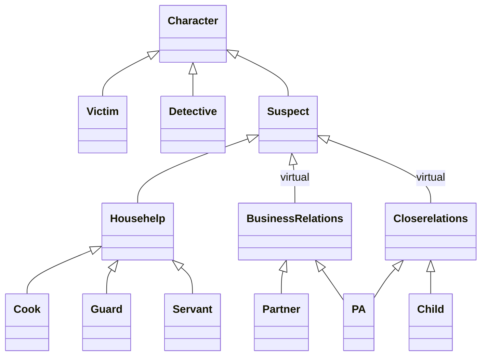

# The Locker Heist

A console-based detective investigation and word-puzzle game written in C++ and built around Object-Oriented Programming (OOP) principles.

Developed as a semester project for **CL1004 - Object Oriented Programming (Section SE-3A, Fall 2026)**.

---

## Storyline

A wealthy business owner, **Mr. Leonardo**, hosted a party at his cottage. During the evening, a hidden locker behind a bookshelf in the Study Room—containing valuable documents and assets—was robbed. Eight people were present at the cottage that night, and one of the seven suspects is the culprit.

Hired by the owner's Personal Assistant (**Mr. Jad**), you take on the role of a private detective. Explore the cottage, interview those present, gather letter clues onto a two-row Scrabble board, deduce the culprit's role from the resulting words, and make your accusation before your credibility or turns run out.

---

## Gameplay & Mechanics

### Core Loop
1. **Visit Locations** — Search the 7 rooms and areas of the cottage (`Bedroom_1`, `Bedroom_2`, `Study_Room`, `Garden`, `Kitchen`, `Dining_Room`, `Living_Room`) to collect letter tiles and their positions for **Word 1** (7 letters).
2. **Interview Characters** — Question the 8 people at the cottage (the victim and 7 suspects) to collect letter tiles and their positions for **Word 2** (8 letters).
3. **Inspect the Board** — View the `TileRack` and `Scrabble` board at any time without consuming a turn.
4. **Form Words** — Once a row on the Scrabble board is completely filled, form and submit the target word for that row.
5. **Accuse the Culprit** — Use the two solved clue words to identify the culprit's role and accuse the matching suspect.

### Rules & Scoring
Configured via [`rules.txt`](rules.txt):

| Rule | Value |
|---|---|
| **Maximum Turns** | `25` |
| **Starting Credibility** | `100` |
| **Wrong Turn / Invalid Input Penalty** | `-5` Credibility |
| **Wrong Word Guess Penalty** | `-10` Credibility |
| **Win Condition** | Accuse the true culprit |
| **Lose Condition** | Credibility reaches `0` or all `25` turns are exhausted |

### Credibility Gates
Characters restrict interviews based on your current credibility through polymorphic `checkAllowed(int credibility)` checks:

| Role / Class | Minimum Credibility Required |
|---|---|
| **Victim** (`Mr. Leonardo`) | `80` |
| **Child** (`Ms. Celine`) | `75` |
| **Partner** (`Ms. Ruslana`, `Mr. Dmitry`) | `50` |
| **PA** (`Mr. Jad`) | `35` |
| **Househelp** (`Cook`, `Guard`, `Servant`) | `0` (Always available) |

### Menu Reference
- **Main Menu:** `[1] New Game` · `[2] View Leader/Score Board` · `[3] About` · `[4] Rules` · `[5] Exit`
- **Game Menu:** `[1] Visit a Location` · `[2] Interview a Person` · `[3] View Scrabble Board (free)` · `[4] Form a Word` · `[5] Accuse a Suspect` · `[6] Quit`

---

## OOP Architecture

The codebase separates declarations, game engine logic, and the top-level driver cleanly across [`heist.h`](heist.h), [`heist.cpp`](heist.cpp), and [`main.cpp`](main.cpp):

- **Abstraction & Polymorphism:** `Character` is an abstract base class with pure virtual `display()` and virtual `checkAllowed(int)` / `isSuspect()`, allowing `GameEngine` to manage all 8 characters uniformly via `Character* characters[8]`.
- **Single, Multiple & Virtual Inheritance:** `BusinessRelations` and `Closerelations` inherit virtually from `Suspect` (`virtual public Suspect`) so `PA` can inherit from both without diamond-problem ambiguity.
- **Singleton Pattern:** `GameEngine` uses a private constructor and `GameEngine::getInstance()` with copy construction and assignment disabled.
- **Generic Programming (Templates):** `DynamicArray<T>` provides a resizable container with automatic capacity doubling, bounds-checked `operator[]`, and Rule-of-Three memory management.
- **Dynamic Memory & Rule of Three:** `Scrabble` manages dynamically allocated `Tile*` rows (`row1`, `row2`) with a custom copy constructor, copy assignment operator, and destructor.
- **Composition, Aggregation & Association:**
  - `TileRack` composes `DynamicArray<Tile>` and `Cottage` composes `DynamicArray<Location>`.
  - `GameEngine` manages `Detective`, `Cottage`, `Scrabble`, `TileRack`, and `Character*` instances, and associates with `ScoreBoard` via `attachScoreBoard()`.
- **Operator Overloading:** Stream insertion (`operator<<`) for `Clue`, `TileRack`, `Scrabble`, and `Cottage`; `operator+=` for `TileRack` and `Scrabble`; `operator[]` for `DynamicArray<T>` and `TileRack`.
- **Exception Handling:** Custom `GameException` hierarchy with polymorphic `getPenalty()` and `isFatal()`, caught centrally in [`main.cpp`](main.cpp) and routed to `GameEngine::handleException()`.

### Character Class Hierarchy



### Exception Hierarchy

- `GameException`
  - `InvalidWordException` (`-10` credibility penalty)
  - `InvalidInputException` (`-5` credibility penalty)
  - `InvalidPositionException` → `InvalidPlacementException`
  - `InvalidActionException`
  - `RackFullException`
  - `IndexOutOfRangeException`
  - `IncompleteWordException`
  - `DataException` (fatal data-loading error)

---

## Project Structure

```text
.
├── main.cpp                  # Entry point, main game loop, top-level exception handling
├── heist.h                   # Enums, structs, templates, exception & class declarations
├── heist.cpp                 # Class implementations, file I/O, GameEngine & ScoreBoard logic
├── characters.txt            # Character profiles and Word 2 letter mappings per culprit
├── locations.txt             # Cottage locations and Word 1 letter mappings per culprit
├── clue.txt                  # Target Word 1 & Word 2 pairs for each culprit role
├── rules.txt                 # Turn limit, starting credibility, penalties, and win/lose text
├── about.txt                 # Course metadata, storyline, and game overview
└── leader/
    └── scoreBoard.txt        # Persistent pipe-delimited record of completed games
```

---

## Build & Run

### Using g++ (MinGW / GCC)

```bash
g++ main.cpp heist.cpp -o heist.exe
```

Run the compiled executable from the project root directory:

```bash
./heist.exe
```

*(In Windows Command Prompt, run `heist.exe`.)*

### Using Visual Studio

1. Create a new **C++ Console App** project.
2. Add `main.cpp` and `heist.cpp` to **Source Files**, and `heist.h` to **Header Files**.
3. Place all `.txt` data files and the `leader/` folder in the executable's working directory.
4. Build and run (`Ctrl + F5`).

> **Note:** Ensure all `.txt` data files and `leader/scoreBoard.txt` remain in the same working directory as `heist.exe`. When entering a detective name, avoid spaces and `|` characters (use `_` or `.` instead).

---

## Team & Course Information

| Name | Roll Number | Contribution |
|---|---|---|
| **M. Huzaifa** | `25F-6036` | Modules & testing |
| **Rahim Nasir** | `25F-3087` | Modules & testing |

- **Course:** CL1004 - Object Oriented Programming
- **Section:** SE-3A
- **Semester:** Fall 2026
- **Lab Instructor:** Mohzeb Ahmad Khan

---

## Known Limitations

- Terminal-based UI relying on `system("cls")` for screen clearing (Windows-oriented).
- Scoreboard persistence uses plain-text storage in `leader/scoreBoard.txt` rather than a database.
- Data files and `leader/scoreBoard.txt` are resolved relative to the current working directory.
